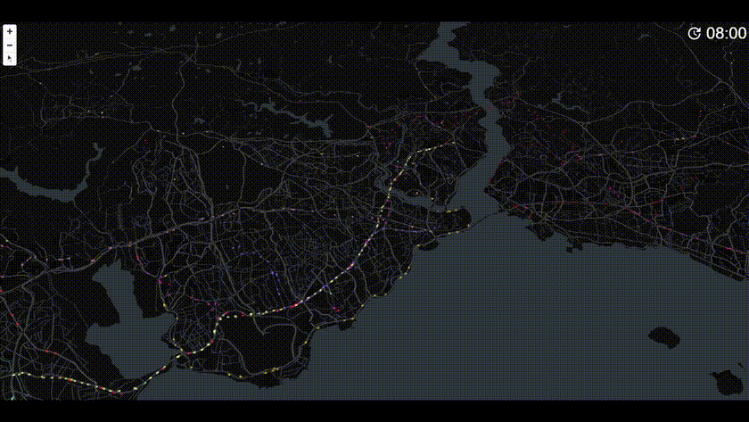

# DeckIst

DeckIst is a hobby project that offers a visual depiction of daily bus traffic in Istanbul. Leveraging the
[bus schedules](https://data.ibb.gov.tr/dataset/iett-gtfs-verisi) and [bus route lines](https://data.ibb.gov.tr/dataset/iett-hat-guzergahlari)
of İETT, Istanbul's public bus operator, published by The Istanbul Metropolitan Municipality, DeckIst employs [Deck.gl](https://deck.gl/) by Uber to offer an enjoyable visual experience for users,
allowing them to explore the city's bus traffic patterns through captivating visualizations. Inspired Uber's visualization of [NYC Taxi Trip](https://deck.gl/examples/trips-layer) data.

## Live Version

Explore the live version of DeckIst [here](https://master.d1ajan0e0wrjix.amplifyapp.com).

## Project Overview

DeckIst comprises two components:

### Webservice

The backend of DeckIst is developed using FastAPI. This component is responsible for processing data and manipulate the
bus traffic data. For more technical details, refer to the [Webservice README](webservice/README.md).

### Frontend

The frontend of DeckIst is built with React and utilizes Deck.gl to create captivating visualizations of the bus traffic
data. Users can visualize their preferred bus lines at different times of the day, allowing for interactive exploration
of bus traffic trends. For more technical details, refer to the [Frontend README](frontend/README.md).

## Approach

Project utilizes a straightforward approach to visualize bus traffic in Istanbul. It combines two datasets: the
schedules tell when each bus trip runs and which stops it serves, and the route lines tell where the bus drives.
Each trip is placed on its route line and its travel time is spread along the distance driven, so buses follow the
road from the first stop to the last. For how the datasets are matched, refer to the
[Webservice README](webservice/README.md#how-trips-are-drawn).

## How to Use

To run DeckIst, simply follow these steps:

1. **Run the Webservice**: Start the FastAPI-based backend to handle data processing and serve data endpoints.
2. **Launch the Frontend**: Access the React-based frontend to visualize the bus traffic data using Deck.gl. The
   frontend provides a user-friendly interface for exploring the data interactively.

## License

DeckIst is licensed under the [MIT License](LICENSE), allowing for flexibility in use and distribution.

## Data License

It's important to note that while the code for this repository is licensed under the MIT License, the GTFS dataset used
in the project is subject to its own licensing terms. Users should refer to the
specifics [licensing information](https://data.ibb.gov.tr/license) provided by The Istanbul Metropolitan Municipality for
the dataset.
